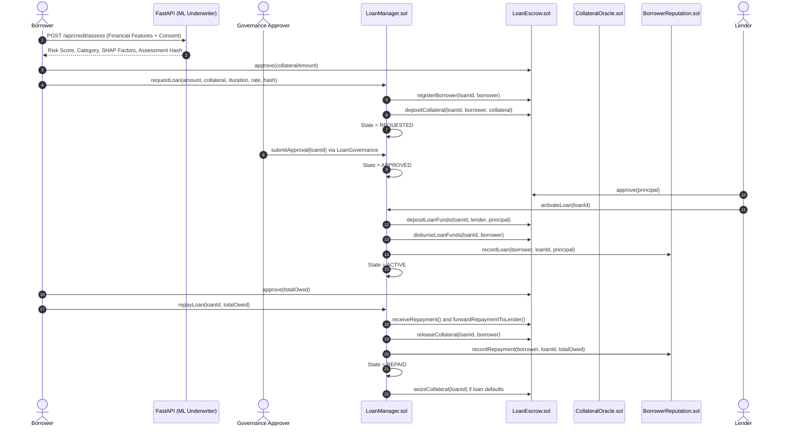

# CredChain — System Architecture Documentation

## 1. Executive Abstract

**CredChain** is an AI-powered decentralized credit scoring and micro-lending platform that unites machine learning underwriting, Ethereum smart contracts, non-custodial token escrow, role-based governance authorization, Chainlink decentralized oracles, and deterministic on-chain borrower reputation.

Designed for individuals with limited traditional credit footprints, CredChain evaluates consented financial signals off-chain using a calibrated machine learning pipeline while enforcing financial custody, loan status progression, and collateral management purely through verifiable smart contracts.

---

## 2. On-Chain vs. Off-Chain Architectural Boundary

```
┌────────────────────────────────────────────────────────────────────────┐
│                          OFF-CHAIN SUBSYSTEM                            │
│                                                                        │
│   Borrower Form Input ──► FastAPI Service (Python 3.12)                 │
│                              │                                         │
│                              ▼                                         │
│                      GradientBoosting ML                               │
│                   Calibrated Default Scorer                            │
│                              │                                         │
│                              ▼                                         │
│                Risk Score + SHAP Contributing Factors                  │
│                + Keccak256 Assessment Hash                             │
└──────────────────────────────┬─────────────────────────────────────────┘
                               │
               Wallet Signs Hash & Loan Terms
                               │
┌──────────────────────────────▼─────────────────────────────────────────┐
│                          ON-CHAIN SUBSYSTEM                            │
│                         (Ethereum Sepolia)                             │
│                                                                        │
│   ┌───────────────────┐               ┌──────────────────────────┐    │
│   │  LoanManager.sol  │◄─────────────►│     LoanEscrow.sol       │    │
│   │ (State Machine)   │               │ (Non-Custodial Custody)  │    │
│   └─────────┬─────────┘               └─────────────┬────────────┘    │
│             │                                       │                 │
│             ▼                                       ▼                 │
│   ┌───────────────────┐               ┌──────────────────────────┐    │
│   │LoanGovernance.sol │               │      CredToken.sol       │    │
│   │(Multi-Sig Auth)   │               │   (ERC-20 Test Asset)    │    │
│   └─────────┬─────────┘               └──────────────────────────┘    │
│             │                                                         │
│             ▼                                                         │
│   ┌───────────────────┐               ┌──────────────────────────┐    │
│   │ CollateralOracle  │◄─────────────►│    BorrowerReputation    │    │
│   │(Chainlink ETH/USD)│               │ (Deterministic Scoring)  │    │
│   └───────────────────┘               └──────────────────────────┘    │
└────────────────────────────────────────────────────────────────────────┘
```

---

## 3. Four Core Blockchain Modules

| Module | Core Contract(s) | Primary Concept | Assigned Owner |
|---|---|---|---|
| **Module 1** | `LoanManager.sol` | State machines, event-driven transitions, loan lifecycles | Member 1 |
| **Module 2** | `CredToken.sol`, `LoanEscrow.sol` | ERC-20 standard, checks-effects-interactions, collateral locking & custody | Member 2 |
| **Module 3** | `LoanGovernance.sol` | Role-based access control (RBAC), multi-signature consensus, pausable emergency stops | Member 3 |
| **Module 4** | `CollateralOracle.sol`, `BorrowerReputation.sol` | Chainlink price feeds, staleness detection, deterministic on-chain reputation | Member 4 |

---

## 4. End-to-End Workflow Diagram


